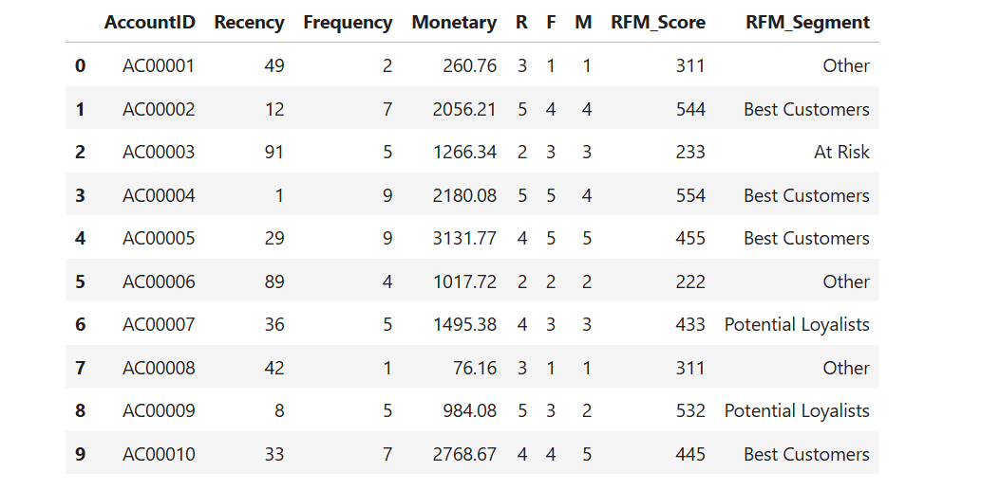

# AI Against Fraud: Revolutionizing Financial Transaction Security

## Project Overview
An AI-powered financial transaction anomaly detection system that uses Machine Learning to identify unusual and potentially suspicious banking transactions through data analysis and customer behavior patterns.

## Objectives
- Analyze banking transaction data.
- Identify unusual transaction patterns.
- Apply unsupervised machine learning algorithms.
- Visualize transaction anomalies through an interactive dashboard.

## AI & Machine Learning Algorithms
- Isolation Forest
- K-Means Clustering
- DBSCAN
- Local Outlier Factor (LOF)
- Principal Component Analysis (PCA)

## Technologies Used
- Python
- Machine Learning
- Scikit-learn
- Pandas and NumPy
- SciPy
- Matplotlib and Seaborn
- Streamlit
- Jupyter Notebook

## Key Features
- CSV dataset upload and preview
- Data preprocessing and feature engineering
- Isolation Forest model training
- Anomaly score calculation
- Transaction anomaly visualization
- PCA-based visualization
- Downloadable prediction results

## Project Structure
- `app.py` – Streamlit application
- `Fraud_Detection.ipynb` – Machine learning analysis and experiments
- `requirements.txt` – Python dependencies
- `.gitignore` – Files excluded from version control

## Installation

```bash
git clone https://github.com/saiprasanna19320/AI-Against-Fraud-Revolutionizing-Financial-Transaction-Security.git
cd AI-Against-Fraud-Revolutionizing-Financial-Transaction-Security
pip install -r requirements.txt
streamlit run app.py
```

## Outcome
An interactive machine learning application for identifying and visualizing potentially suspicious financial transaction patterns.

## Author
Tholem Sai Prasanna

GitHub: https://github.com/saiprasanna19320


### Dataset Upload

